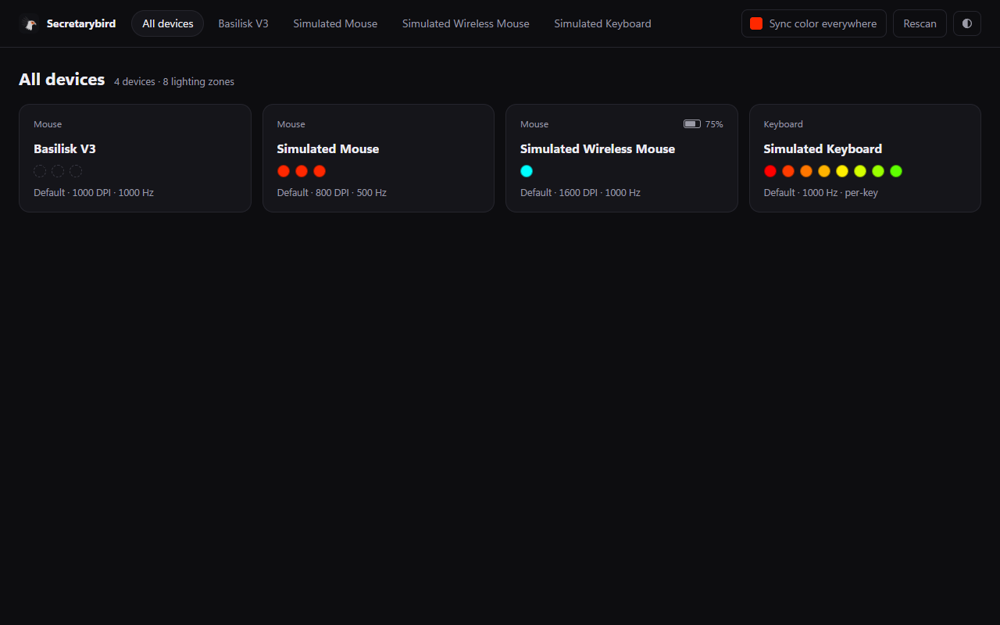
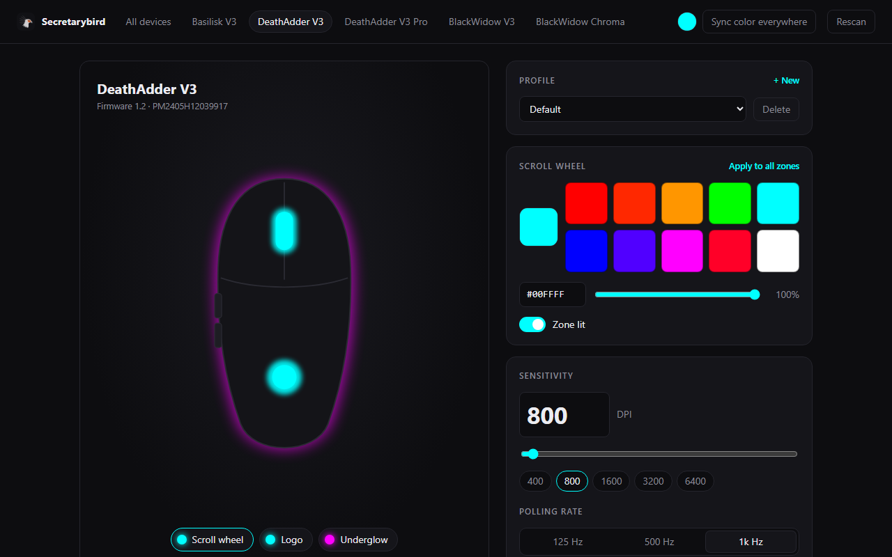
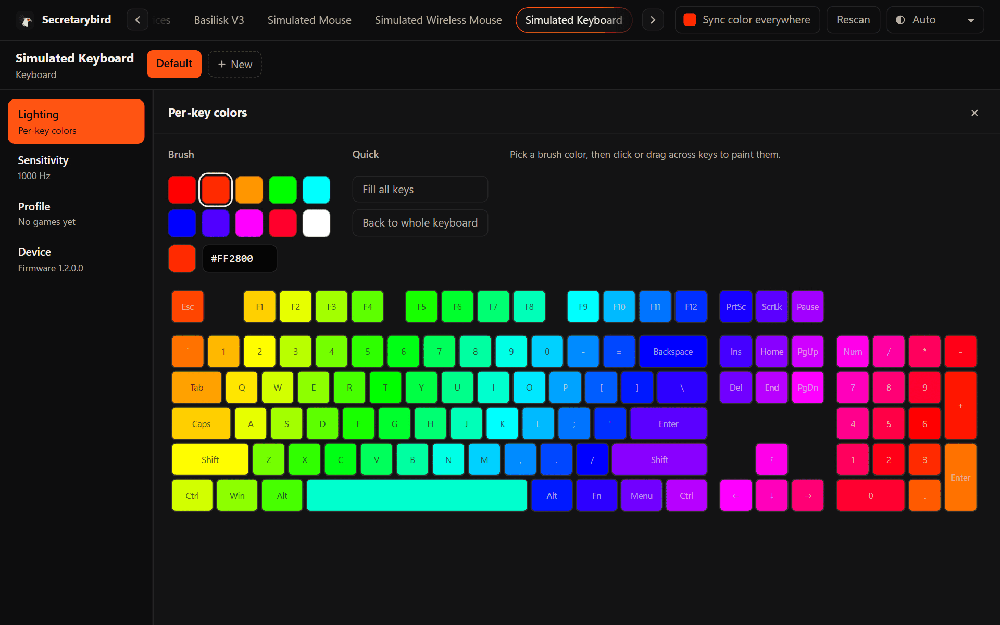

<picture>
  <source media="(prefers-color-scheme: light)" srcset="docs/banner-light.png">
  
</picture>

A small, lightweight replacement for Razer Synapse on Windows. Set your Razer mouse,
keyboard and other peripherals: lighting, DPI, polling rate and profiles, without
Synapse's background services, account, ads, pop-ups or restart prompts.

- **Light:** a 650 KB tray app using about 11 MB of RAM, next to the hundreds of MB Synapse keeps running.
- **Quiet:** no services, no updater, no telemetry, no internet. It sits in the tray and
  applies your settings when you sign in, plug a device in or wake the PC.
- **Built for many devices:** one screen for all of them, and one click to sync a color everywhere.

> **Beta.** Only the Basilisk V3 has been tested on real hardware so far. Other devices are
> supported from public protocol facts and may not work yet. [Tell us how yours does](#help-us-support-your-device).

### [⬇ Download for Windows](https://github.com/infinityInfinite/secbird/releases/latest)

Free · Windows 10 and 11 · on the page that opens, click `Secretarybird-Setup-<version>.exe`.



## Install

1. Go to the [**latest release**](https://github.com/infinityInfinite/secbird/releases/latest) and download
   `Secretarybird-Setup-<version>.exe`.
2. Run it. It installs for your Windows account only, so it doesn't ask for administrator rights.
3. The bird appears in the tray (click `^` next to the clock if it's hidden).
   Click it and choose **Open editor**.

**"Windows protected your PC"?** The installer isn't code-signed yet (signing costs money),
so Windows SmartScreen doesn't know it. Click **More info → Run anyway**. To check your download
matches the release, compare `Get-FileHash Secretarybird-Setup-<version>.exe` in PowerShell
with `SHA256SUMS.txt` on the release page.

Prefer no installer? Download `Secretarybird-<version>-portable.zip` instead, unzip it anywhere
and run `secbird-tray.exe`.

**Updating:** run the newer installer; your settings are kept.
**Uninstalling:** Windows Settings → Apps → Secretarybird. It asks whether to keep your profiles.

## Using it

| Mouse | Keyboard, per-key |
|---|---|
|  |  |

<sub>Screenshots: the Basilisk V3 is real hardware; the other devices are simulated to show the editor.</sub>

- **Tray icon:** switch profiles per device, re-apply settings, Start with Windows. Hover it to see
  each device's profile and battery.
- **Editor:** opens in your browser but runs only on your PC (`127.0.0.1`), protected by a
  one-time key. Colors and brightness per zone, DPI, polling rate, profiles, and paint-by-key on
  keyboards with per-key lighting.
- **Profiles** are saved per physical device, so two identical mice keep their own settings.
  Back them up with `secbird export backup.json`.
- **Per-app profiles:** tie a profile to games or apps (in the editor's Profile card, or
  `secbird profile apps Gaming cs2.exe`). It switches while that program is in front and goes
  back when you leave it. Windows tells the tray when the window in front changes, so nothing polls.

## Moving from Synapse

1. Close Synapse (tray icon → Exit). If both run, Synapse overwrites your settings, and
   Secretarybird warns you about that.
2. Optional: turn off Razer's background services and startup entries with `secbird debloat`
   (below), or uninstall Synapse completely. Your devices keep working: Secretarybird talks to
   them directly and doesn't need Razer's services.

## Command line

The installer can add `secbird` to PATH (tick the box); otherwise run it from the install folder,
`%LOCALAPPDATA%\Programs\Secretarybird`.

```
secbird list                    connected devices
secbird info                    firmware, serial, DPI, polling rate, battery
secbird dpi 1600                set DPI
secbird poll 1000               set polling rate
secbird color logo FF8800       static color for a zone
secbird keys 00FFAA             every key one color (per-key keyboards)
secbird sync 00FFAA             same color on every device
secbird profile new gaming      profiles per device
secbird profile apps gaming cs2.exe   switch to a profile while a program is in front
secbird export backup.json      save all profiles to a file
secbird report                  read-only description of your hardware, for issues
secbird --version
```

Run `secbird help` for everything. With several devices connected, pick one with `-d PID` or
`-d SERIAL`.

### Debloat

- `secbird debloat` only **lists** what Razer runs in the background.
- `secbird debloat apply` turns it off. It needs a terminal opened with **Run as administrator**,
  prints every Windows command before running it, and saves a backup.
- `secbird debloat undo` puts back exactly what `apply` changed.

Drivers are never touched.

## Help us support your device

Run `secbird report` and [open a device report](https://github.com/infinityInfinite/secbird/issues/new?template=device-report.yml),
saying what works and what doesn't. The report only reads from your devices and shortens serial
numbers. Reports are how devices move from "listed" to "verified".

| Status | Devices |
|---|---|
| Verified on real hardware | Basilisk V3 |
| Listed, waiting for reports | 273 more mice, keyboards, keypads, mousepads, laptops and accessories |
| Not supported yet | Kraken headsets, laptop cooling pads |

## Files

Settings live in `%APPDATA%\Secretarybird`: `profiles.json`, `secbird.log` (helpful for bug
reports) and an optional `devices.json` override. The tray menu has **Open settings folder**.

## Build from source

Needs Rust (stable, MSVC) on Windows 10/11.

```
cargo build --release
```

The installer is built with [Inno Setup 6](https://jrsoftware.org/isinfo.php):
`ISCC.exe /DAppVersion=0.1.0 installer\secbird.iss`. Pushing a `v*` tag builds the installer,
portable zip and checksums on GitHub into a draft release.

To try the editor without hardware, start the tray with simulated devices:

```
$env:SECBIRD_SIM="mouse,wireless,keyboard,old-keyboard"
.\target\release\secbird-tray.exe
```

## Legal

Secretarybird contains no code or assets from Razer. Device facts are restated from the OpenRazer
project; see [NOTICE](NOTICE). Razer, Synapse and Chroma are trademarks of Razer Inc.; this project
is not affiliated with or endorsed by Razer.

Licensed under either of [MIT](LICENSE-MIT) or [Apache-2.0](LICENSE-APACHE), at your option.
